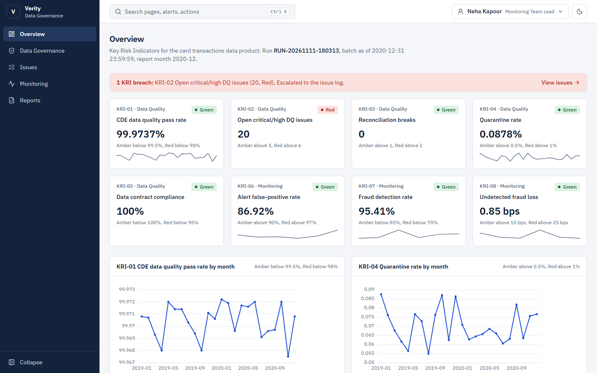
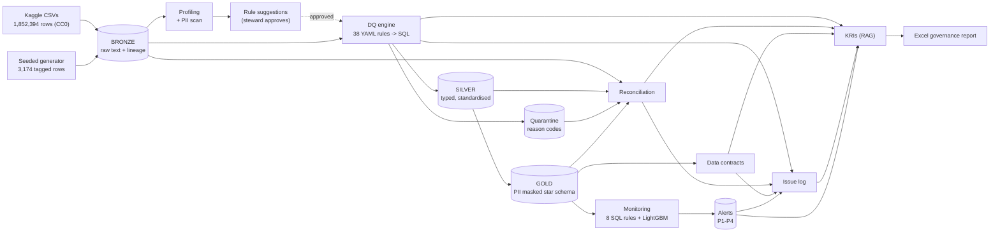
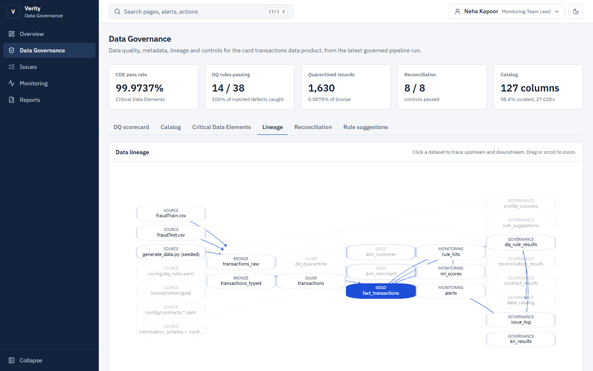
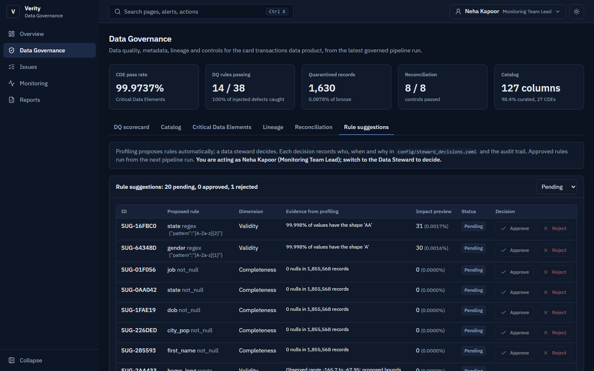
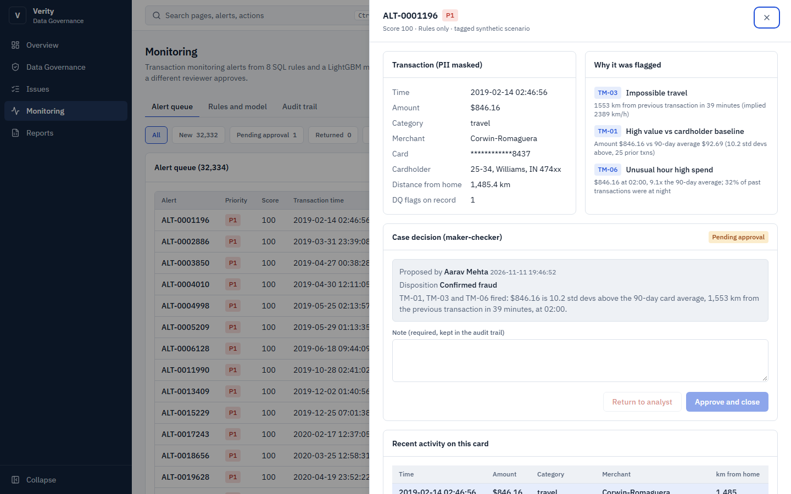
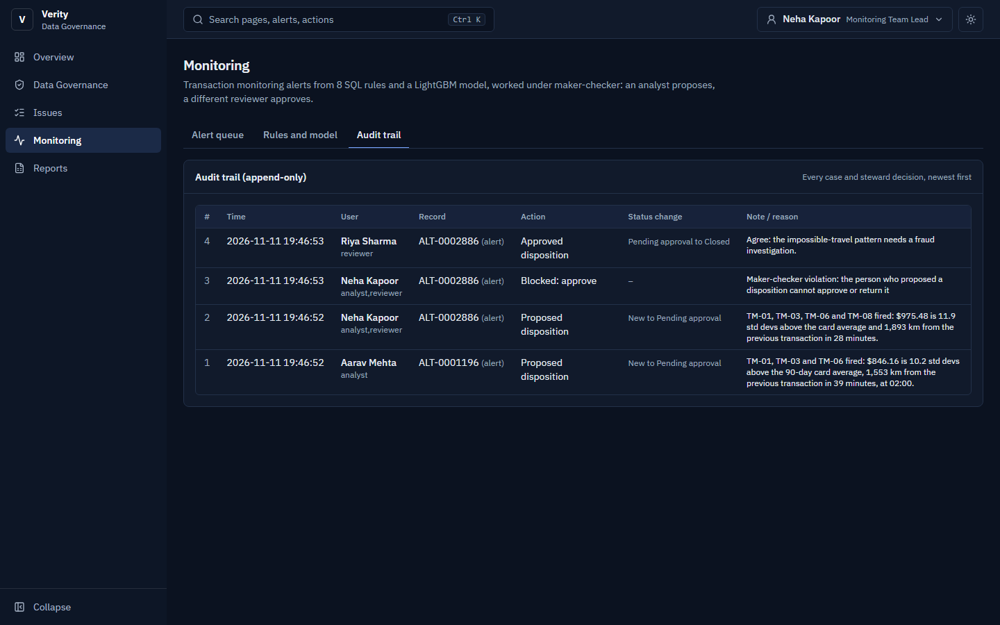
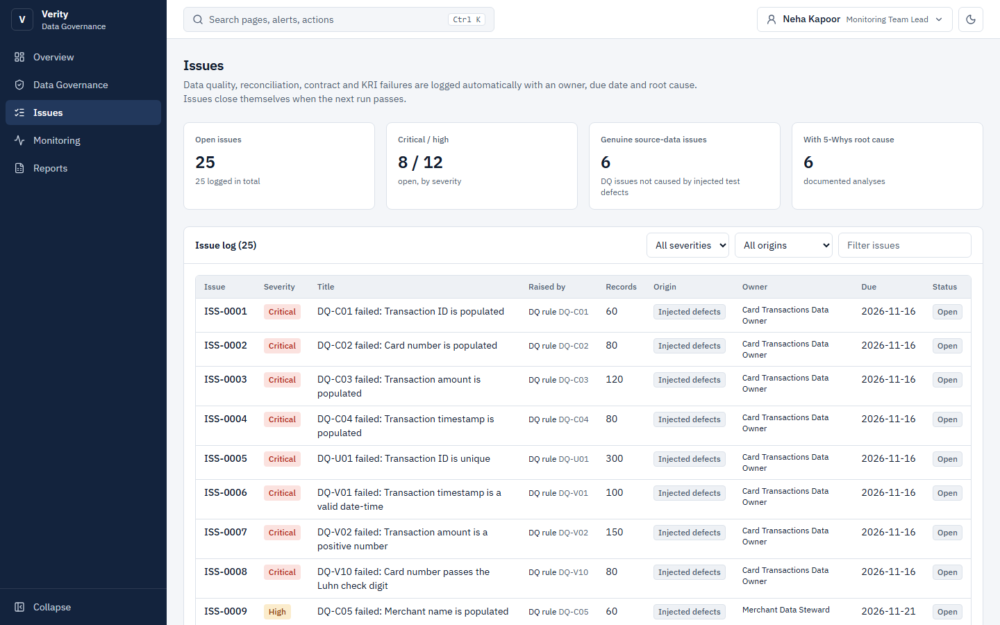
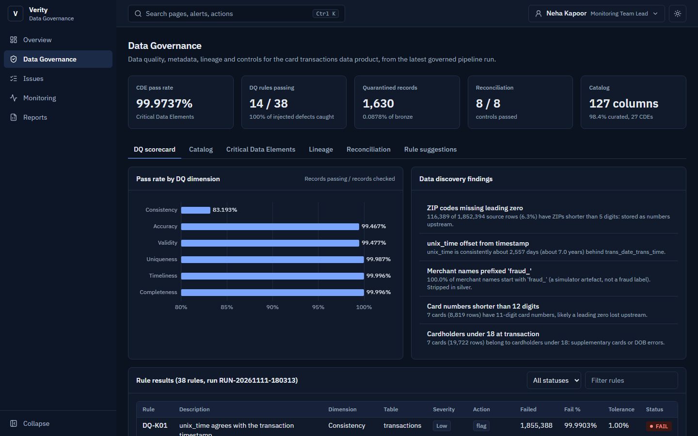

# Verity – Data Quality, Governance & Transaction Monitoring Platform

[](https://github.com/mkohlibe24-cell/verity-data-governance/actions/workflows/ci.yml)

Verity takes 1.85 million card transactions from raw files to governed, PII-protected data
products. Along the way it runs automated data discovery, a config-driven data quality engine
with quarantine, reconciliation controls, a data catalog, data contracts, auto-generated lineage,
an issue log and Key Risk Indicators. On top of the governed data it builds a transaction
monitoring data product (8 SQL rules plus an ML risk score) and reports everything in a management
Excel workbook. One command runs it end to end. A FastAPI + React web app puts the governance
results, the data steward's approval queue and the alert queue (with maker-checker enforced by the
API) in front of business users.



## The business problem

Regulatory and management reports are only as reliable as the data underneath them. A data office
has to answer, with evidence: *Where did this number come from? Is the data complete and valid? Who
owns it? Was anything lost or duplicated on the way? Is personal data protected? What breaks, who
fixes it, and by when?* Verity answers those questions for a card transactions domain. It then shows
that a data product built on governed data (fraud monitoring) can be trusted and measured.

## What Verity does

| Area | What is built | Where |
|---|---|---|
| Ingestion | Raw files landed as text in a bronze layer with lineage columns; source manifest with SHA-256 checksums, record counts and amount totals | `pipeline/ingest.py` |
| Data discovery | Automated profiling of every column (nulls, distinct, ranges, percentiles, outliers, value patterns) and a PII scan, including a value-based card-number check | `reports/data_profile.md` |
| Data quality | 38 rules in YAML across 6 dimensions, compiled to SQL; failing records quarantined with reason codes; scorecards by table, CDE, dimension and month | `config/dq_rules.yaml`, `reports/dq_scorecard.md` |
| Automation + human-in-the-loop | Rules suggested automatically from the profile, with an impact preview; a data steward approves or rejects each one, and the decision is recorded | `pipeline/rule_suggester.py`, `pipeline/steward.py` |
| Privacy | Gold layer with salted SHA-256 card tokens, masked names, birth year instead of DOB, street removed | `pipeline/gold.py` |
| Reconciliation | 8 controls tying record counts and amounts from source files to gold, to the cent | `pipeline/reconciliation.py` |
| Metadata | Data catalog (technical + curated business metadata, sensitivity, CDE reasons), lineage generated from the run, data contracts for 4 data products | `docs/` |
| Controls and issues | Control inventory (64 controls); issue log opened automatically from failures, with owners, SLAs and 5-Whys root causes | `docs/control_inventory.md`, `reports/issue_log.md` |
| Monitoring data product | 8 SQL detective rules (window functions, CTEs), LightGBM + Isolation Forest with a time-based split, a cost-based threshold and per-alert SHAP reasons | `sql/monitoring/`, `pipeline/ml.py` |
| KRIs and reporting | 8 KRIs with red/amber/green thresholds; Excel "Data Quality & Governance Report" | `reports/Verity_DQ_Governance_Report.xlsx` |
| Web app | FastAPI API (roles enforced server-side, maker-checker, audit trail) and a React app: Overview, Data Governance, Issues, Monitoring, Reports | `api/`, `web/` |
| Engineering | One-command pipeline with run audit log, 50 pytest tests, GitHub Actions CI (lint, tests, sample run, web build) | `pipeline/run_pipeline.py`, `tests/` |

## Architecture



## Key results (full run `RUN-20261111-180313`, all numbers from `reports/results.json`)

**Data quality and governance**

| Metric | Result |
|---|---|
| Records processed | 1,855,568 (1,852,394 source + 3,174 generator-tagged) |
| DQ rules | 38 across 6 dimensions (17 preventive quarantine rules, 21 detective flag rules) |
| Records quarantined (with reason codes) | 1,630 (0.09%); nothing dropped: bronze = silver + quarantine |
| Injected defects detected | 1,960 of 1,960 (100%) across 23 defect types |
| Real source-data issues found | 6: 116,389 ZIPs missing a leading zero; 7 cards (8,819 rows) with 11-digit card numbers; `unix_time` offset by ~7 years on every row; 7 merchants under two categories; 19,722 rows with cardholders under 18; no transactions at all on 29 Feb 2020 (the leap day is missing) |
| CDE data quality pass rate | 99.97% |
| Reconciliation | 8 of 8 controls tie out (counts and amounts to the cent, source to gold) |
| PII | 12 columns flagged by the profiler; none in raw form in gold |
| Rule suggestions from profiling | 21 proposed: 1 rejected by the data steward (range learned from corrupted records), 20 pending review |
| Catalog / contracts / controls | 127 columns (98.4% curated, 27 CDEs); 4 contracts, 32 of 32 clauses passed; 64 controls |
| Issue log | 25 open issues: 24 from DQ rules (18 caused only by injected test defects, 6 by genuine source-data issues with 5-Whys root causes) and 1 from a KRI breach |

**Monitoring data product (test period Jul-Dec 2020: 525,909 transactions, 2,237 fraud)**

| Approach | Alerts | Precision | Recall | PR-AUC |
|---|---|---|---|---|
| 8 SQL rules | 8,436 | 16.8% | 63.4% | n/a |
| Isolation Forest (no labels) | 11,483 | 13.6% | 69.7% | 0.360 |
| LightGBM | 2,589 | 80.5% | 93.2% | 0.956 |
| Hybrid (rules OR LightGBM) | 9,427 | 22.5% | 94.8% | n/a |

- On original (non-injected) fraud, the ML layer caught **89.2% of the fraud the rules missed**
  (659 of 739). The rules caught 22 cases the model missed, and they remain stronger on rare known
  patterns such as impossible travel and structuring.
- Undetected fraud fell from USD 152,822 (rules only) to USD 7,367 (hybrid).
- The threshold (0.10) was chosen on a separate validation month by cost (USD 15 per false alarm,
  the amount of each missed fraud), within an analyst capacity of 40 alerts a day.
- Accuracy is not used: a model that never flags fraud would score 99.57% on this period.
- Two full runs produce identical results (deterministic training and tie-broken SQL windows).
- December 2020 KRIs: fraud detection rate 95.4% (Green), alert false-positive rate 86.9% (Green),
  undetected fraud loss 0.85 bps of spend (Green). KRI-02 (open critical/high issues) is Red
  by design, because defects were injected to exercise the controls.

**Read these honestly.** The source is a public *simulation*, and its fraud is easier to learn than
real fraud, so model scores are higher than a real portfolio would show. Generator rows are always
tagged, and the headline ML comparison is also reported on original fraud only.

## Web app

FastAPI reads the warehouse read-only and serves a React + TypeScript app. Every number on screen
comes from the latest full run; nothing is hard-coded.

| Page | What it shows |
|---|---|
| Overview | 8 KRIs with RAG status, thresholds and trends; breach banner linked to the issue log; alerts by month and priority; rules vs ML vs hybrid on the test period |
| Data Governance | DQ scorecard, catalog search, Critical Data Elements, interactive lineage (click a dataset to see everything upstream and downstream), reconciliation, rule suggestions with steward Approve/Reject |
| Issues | Issue log with severity, origin (genuine source data vs injected test defects), owner and due date; 5-Whys root cause in a side panel |
| Monitoring | Alert queue (32,334 alerts, server-side paging and filters), alert detail with masked transaction, rule and model reasons and recent card activity; case decisions under maker-checker; append-only audit trail; rule and model performance |
| Reports | Excel report download, generated reports, pipeline run audit log, source file manifest with SHA-256 |

**Controls enforced by the API, not the browser.** Users are made-up demo identities picked with the
role switcher (a real deployment would use SSO). The server looks up each user's roles:

| Demo user | Role | Can |
|---|---|---|
| Aarav Mehta | Monitoring Analyst | Propose an alert disposition (maker) |
| Riya Sharma | Monitoring Reviewer | Approve or return a proposal (checker) |
| Neha Kapoor | Team Lead (analyst + reviewer) | Both, but never check her own proposal |
| Kabir Singh | Data Steward | Approve or reject suggested DQ rules |
| Ira Banerjee | Internal Audit | Read only |

A self-approval returns HTTP 403 and is itself written to the audit trail as a blocked attempt. Every
decision needs a note. Alert case history is kept in `warehouse/casework.sqlite`, separate from the
warehouse, so re-running the pipeline never loses it. Steward decisions go to
`config/steward_decisions.yaml` through the same function the command line uses. The case actions
visible in the screenshots (two proposals, one approval, one blocked self-approval) were made through
the API as a demo.

| | |
|---|---|
|  |  |
|  |  |
|  |  |

All pages at 1440px and 1024px in light and dark mode are in [`docs/screenshots/`](docs/screenshots),
captured by `web/scripts/screenshots.mjs` (Playwright).

**Design rules followed:** navy/slate palette with one blue accent, red/amber/green used only for
status, WCAG AA contrast, IBM Plex Sans with tabular numerals, an 8px spacing grid, Lucide icons,
no emojis, ECharts with muted gridlines, 150-250 ms motion that is switched off under
`prefers-reduced-motion`, loading, empty and error states on every view, a collapsible sidebar, and
a Ctrl+K command palette (pages, sections, alert IDs, theme, user switch).

## Data

- **Source:** [Credit Card Transactions Fraud Detection Dataset](https://www.kaggle.com/datasets/kartik2112/fraud-detection)
  by Kartik Shenoy, licence **CC0: Public Domain**. Simulated with the Sparkov Data Generation tool
  (Brandon Harris). 1,852,394 transactions, 1 Jan 2019 to 31 Dec 2020, 999 cards, 693 merchants,
  with timestamps, merchant, category, amount, cardholder and merchant locations, and fraud labels.
- **Generator (`pipeline/generate_data.py`, fixed seed):** adds 1,214 risk-scenario rows the
  simulator lacks (card testing, velocity bursts, impossible travel, round-amount structuring,
  dormant-account reactivation) and 1,960 deliberately broken records across 23 defect types (nulls,
  duplicates, double postings, negative amounts, bad and future timestamps, invalid codes, Luhn
  failures and more). Every generated row has `is_synthetic = TRUE` and a `synthetic_tag`.
- The full files (500 MB) are not in git. A 30-card CC0 sample (46,136 rows, 3.2 MB) is committed
  in `data/sample/`, so the pipeline runs from a fresh clone and in CI.

## How to run

Requires Python 3.12+ (developed on 3.13) and Git.

```bash
git clone https://github.com/mkohlibe24-cell/verity-data-governance.git
cd verity-data-governance
python -m venv .venv
# Windows: .venv\Scripts\activate      macOS/Linux: source .venv/bin/activate
pip install -r requirements.txt

# Option A - quick run on the committed sample (about 15 seconds)
python pipeline/run_pipeline.py --sample

# Option B - full run (about 2.5 minutes): download the Kaggle zip and save it as
#   data/raw/kaggle_fraud.zip
python pipeline/run_pipeline.py

pytest                          # 50 tests
ruff check pipeline tests api   # lint
```

Web app (after a full run). Requires Node 20+.

```bash
# Terminal 1 - API on http://localhost:8000
uvicorn api.main:app --port 8000

# Terminal 2 - web app on http://localhost:5173 (calls the API through a proxy)
cd web
npm ci
npm run dev

# Or one server: build the app once, then the API serves it at http://localhost:8000
npm run build
```

The API reads `warehouse/verity.duckdb`, which the full run creates. After a sample-only run, copy
`warehouse/verity_sample.duckdb` to `warehouse/verity.duckdb` to browse the sample.

Steward workflow for suggested rules:

```bash
python pipeline/steward.py list
python pipeline/steward.py approve SUG-285593 --by "Your Name" --reason "Matches the data standard"
python pipeline/steward.py reject  SUG-8DAE34 --by "Your Name" --reason "Range learned from corrupted records"
```

Optional: set `VERITY_HASH_SALT` to your own secret before running. Without it, a public demo salt is
used and the log warns about it.

## Outputs

| File | What it is |
|---|---|
| `reports/Verity_DQ_Governance_Report.xlsx` | Management workbook: summary, KRIs, DQ scorecards, rule results, quarantine, reconciliation, issue log, catalog, control inventory, contracts, rule suggestions, monitoring |
| `reports/data_profile.md` | Data discovery: column profile, PII scan, findings |
| `reports/dq_scorecard.md` | Scorecards and every rule's result |
| `reports/issue_log.md` | Issues with owners, due dates and 5-Whys root causes |
| `reports/monitoring_results.md` | Rules vs ML vs hybrid, rule performance, top risk drivers |
| `reports/kri_report.md` | KRI values, RAG status, definitions and escalation |
| `reports/results.json` | Every headline number (the only source for this README) |
| `docs/data_catalog.md`, `docs/lineage.md`, `docs/control_inventory.md`, `docs/data_contracts.md` | Governance documentation generated from the run |
| `DATA_GOVERNANCE.md` | Governance framework: roles, standards, classification, DQ management, BCBS 239 mapping |
| `LEARNING.md` | Every concept explained simply |

## Project structure

```
config/          config.yaml (all thresholds), dq_rules.yaml, catalog_curated.yaml,
                 contracts/, issue_rca.yaml, steward_decisions.yaml
pipeline/        one module per step; run_pipeline.py runs all 16 steps
sql/monitoring/  8 monitoring rules as .sql files
api/             FastAPI app (main.py) and maker-checker case logic (casework.py)
web/             React + Vite + TypeScript app; scripts/screenshots.mjs (Playwright)
tests/           50 pytest tests: hand-made datasets, maker-checker rules, API security
data/sample/     CC0 sample for fresh clones and CI
reports/, docs/  generated outputs
```

## How this maps to the Governance & Control role

| Job description | In Verity |
|---|---|
| Data discovery, ingestion, validation, reporting | Profiling and PII scan; bronze ingestion with source manifest; DQ engine; Excel report and KRIs |
| Developing data products and reporting solutions | Gold star schema with contracts; monitoring alerts data product; management workbook |
| Documenting data processes, standards and governance practices | DATA_GOVERNANCE.md, data catalog, lineage, contracts, control inventory |
| Implementing and monitoring data quality controls | 38 rules, quarantine, reconciliation, scorecards, DQ KRIs |
| Data analysis and validation to identify issues and improvements | 6 real source-data issues found and root-caused; issue log with remediation plans |
| Automating manual processes using emerging technologies | One-command pipeline, run audit log, CI, automated rule suggestions with steward approval |
| SQL querying, validation and analysis | DQ rules compile to SQL; monitoring rules are SQL with window functions and CTEs |
| Data governance, quality and control principles | Three Lines of Defense, preventive vs detective controls, BCBS 239 mapping |
| Preferred: Google Cloud, visualisation and reporting tools | Web app dashboards and Excel report; planned: BigQuery sandbox for DQ and reconciliation, Power BI kit |
| Maintaining a robust control environment | Maker-checker on alert decisions enforced by the API, append-only audit trail, steward approval for new rules |

## Roadmap

- **Done:** FastAPI + React web app (see above).
- **Next:** DQ and reconciliation on a BigQuery sandbox, Power BI build kit, monthly PowerPoint
  report, control-testing workpapers and full RCM, model card, Playwright end-to-end tests,
  deployment (Vercel + Render).

## Limitations

- Simulated source data plus synthetic (tagged) scenarios: the results show what the controls can do,
  not real-world fraud or defect rates.
- The demo hashing salt is public; production would use a secrets manager.
- The web app enforces roles server-side, but identity is a demo header with made-up users, not
  real authentication (production would use SSO). The DuckDB warehouse itself has no row-level
  access control.
