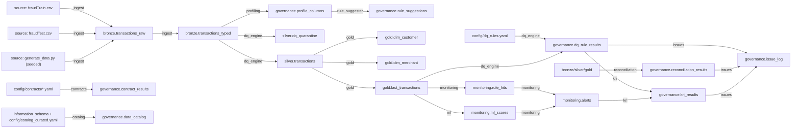

# Data Lineage

_Generated by the pipeline, run `RUN-20261111-180313` (full mode). Do not edit by hand._

Generated from the edges each pipeline step recorded while it ran (not drawn by hand).

## Column-level lineage for personal data

| Bronze | Silver | Gold | Transformation |
|---|---|---|---|
| bronze.cc_num | silver.card_number | gold.dim_customer.card_token | SHA-256(salt + PAN); masked copy keeps last 4 |
| bronze.first / last | silver.first_name / last_name | gold.dim_customer.*_name_masked | First letter kept, rest masked |
| bronze.dob | silver.dob | gold.dim_customer.birth_year, age_band | Generalised to year and band |
| bronze.street | silver.street | (removed) | Not needed by any consumer (data minimisation) |
| bronze.zip | silver.zip (left-padded) | gold.dim_customer.zip3 | Truncated to 3 digits |
| bronze.lat / long | silver.home_lat / home_long | gold.dim_customer.home_*_2dp; fact.distance_from_home_km | Rounded to 2 dp; distance computed before rounding |
| bronze.unix_time | (dropped in silver) | (not in gold) | Unreliable field (issue DQ-K01) |

## Edges

| source | target | step | transformation |
|---|---|---|---|
| source: fraudTrain.csv | bronze.transactions_raw | ingest | Load as text, add lineage columns |
| source: fraudTest.csv | bronze.transactions_raw | ingest | Load as text, add lineage columns |
| source: generate_data.py (seeded) | bronze.transactions_raw | ingest | Tagged synthetic scenarios and DQ defects |
| bronze.transactions_raw | bronze.transactions_typed | ingest | TRY_CAST to types (view) |
| bronze.transactions_typed | governance.profile_columns | profiling | Column statistics and PII scan |
| governance.profile_columns | governance.rule_suggestions | rule_suggester | Profile-driven rule proposals awaiting steward approval |
| bronze.transactions_typed | silver.dq_quarantine | dq_engine | Records failing quarantine rules, with reason codes |
| bronze.transactions_typed | silver.transactions | dq_engine | Passing records; merchant prefix stripped, ZIP left-padded, dq_flags added |
| config/dq_rules.yaml | governance.dq_rule_results | dq_engine | Rule definitions |
| silver.transactions | gold.dim_customer | gold | One row per card; PAN hashed + masked, names masked, DOB -> birth year, street removed |
| silver.transactions | gold.dim_merchant | gold | One row per merchant name; primary category |
| silver.transactions | gold.fact_transactions | gold | Transaction grain; card token, merchant key, distance from home |
| gold.fact_transactions | governance.dq_rule_results | dq_engine | Gold-layer detective rules |
| bronze/silver/gold | governance.reconciliation_results | reconciliation | Counts and amount totals tie-out between layers |
| gold.fact_transactions | monitoring.rule_hits | monitoring | 8 SQL detective rules |
| gold.fact_transactions | monitoring.ml_scores | ml | Behavioural features -> LightGBM + Isolation Forest |
| monitoring.rule_hits | monitoring.alerts | monitoring | One alert per transaction |
| monitoring.ml_scores | monitoring.alerts | monitoring | ML score + reasons (test period) |
| config/contracts/*.yaml | governance.contract_results | contracts | Contract checks on gold |
| information_schema + config/catalog_curated.yaml | governance.data_catalog | catalog | Technical + curated business metadata |
| governance.dq_rule_results | governance.issue_log | issues | Failed rules become issues |
| governance.reconciliation_results | governance.issue_log | issues | Breaks become issues |
| governance.dq_rule_results | governance.kri_results | kri | DQ KRIs |
| monitoring.alerts | governance.kri_results | kri | Monitoring KRIs (report month) |
| governance.kri_results | governance.issue_log | issues | Red KRIs become issues |
